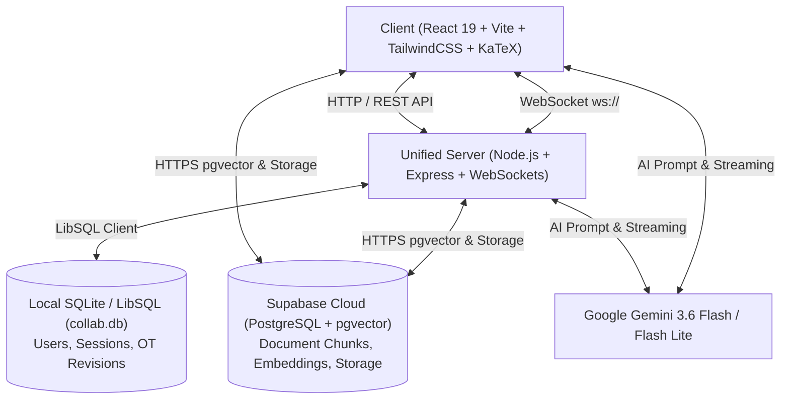

# DocMind Studio 🧠📄

> **Distraction-Free AI Document Intelligence & Real-Time Collaborative Workspace**

[](https://documentary-f6hn.onrender.com)
[](https://react.dev/)
[](https://nodejs.org/)
[](https://supabase.com/)
[](https://ai.google.dev/)

---

## 🌟 Overview

**DocMind Studio** is a unified full-stack document platform that combines **Retrieval-Augmented Generation (RAG)**, **AI Study Guide Synthesis**, **Real-Time Multi-User Collaborative Authoring (OT)**, and **In-App Document Inspection**.

Designed with an elegant editorial aesthetic inspired by Notion and Substack, DocMind allows students, researchers, and teams to upload textbooks, research papers, and technical guides, and instantly generate full step-by-step mathematical solutions, formulas, and verified citations.

---

## ✨ Key Features

### 🔍 1. Grounded RAG & Semantic Vector Search
- **High-Dimensional Embeddings**: 1536-dimensional semantic embeddings stored and indexed using **pgvector** with HNSW cosine similarity.
- **Strict Grounding with Citations**: Answers are grounded directly in uploaded document chunks with verified citations `[Source 1, Page X]`.
- **Intelligent Fallback Architecture**: Automatically cascades across cloud vector RPC (`match_document_chunks`), local TF-IDF semantic keyword matching, and direct content extraction.

### 📚 2. AI Document Solutions & Full-Screen Study Guide
- **Exhaustive Question Solving**: Reads entire problem banks and produces unabridged, question-by-question solutions without skipping intermediate steps.
- **LaTeX Math Rendering**: Formatted with **KaTeX** for fractions ($\frac{a}{b}$), integrals ($\int$), matrices ($\begin{bmatrix}\dots\end{bmatrix}$), and step-by-step derivations.
- **Multi-Mode Analysis**:
  - 📝 **Full Solutions**: Complete step-by-step mathematical problem breakdowns.
  - 📐 **Formulas**: Comprehensive index of all core equations and constants.
  - 🎯 **Study Quiz**: Interactive test questions to test retention.
  - 💡 **Key Points**: High-yield conceptual takeaways and summaries.

### 📖 3. In-App Document & PDF Viewer
- **Integrated Reader Modal**: Open and inspect uploaded PDFs directly in the application without downloading or opening external tabs.
- **Page-by-Page Navigation**: Jump to specific pages, zoom, and inspect original text side-by-side with AI solutions.

### 💬 4. Persistent Multi-Threaded AI Companion
- **ChatGPT-Style Sidebar**: Creates and saves named conversation threads per document or across the entire document library.
- **One-Click Instant Answering**: Suggested questions trigger instant step-by-step streaming answers.
- **Session Continuity**: Chat history persists across browser reloads via dual SQLite and Supabase synchronizations.

### ✍️ 5. Real-Time Collaborative Editor
- **Operational Transformation (OT)**: Built-in custom concurrency control engine handling concurrent character insertions and deletions over WebSockets.
- **Automatic Snapshot Replay**: Real-time sync with conflict resolution and offline-reconnect replay support.

### 🔐 6. Secure Authentication & Email OTP
- **Firewall-Resistant Email Verification**: Dispatches genuine 6-digit OTP codes via Supabase HTTPS mail delivery (Port 443), bypassing cloud SMTP port restrictions on hosting platforms like Render.
- **Password Reset & Account Upsert**: Verified OTP acts as a safe credential reset without account deadlocks.
- **Encrypted Credentials**: Passwords salted and hashed with **bcryptjs** (cost 12), with stateless JSON Web Token (JWT) sessions.

---

## 🏗️ Architecture & Tech Stack



### Technology Highlights
- **Frontend**: React 19, Vite, TailwindCSS, Framer Motion, KaTeX, Lucide Icons.
- **Backend**: Node.js, Express, LibSQL (@libsql/client), WebSocket (`ws`), Nodemailer, JWT.
- **AI / LLM**: Google Gemini 3.6 Flash & Gemini 3.5 Flash via Generative Language API.
- **Database & Storage**: SQLite (local) + Supabase PostgreSQL with `pgvector` & S3 Storage.

---

## 📁 Project Structure

```
Documentary/
├── client/                     # Vite + React Frontend Application
│   ├── src/
│   │   ├── components/         # ChatAssistant, SummaryModal, DocumentViewerModal, Editor
│   │   ├── context/            # AuthContext (OTP, JWT sessions, Supabase Auth)
│   │   ├── lib/                # API client, RAG vector search, KaTeX math formatters
│   │   ├── pages/              # Landing, Auth (Sign In / Register), Dashboard
│   │   ├── index.css           # Minimal Notion/Substack design system
│   │   └── App.jsx             # React Router structure
│   └── package.json
│
├── server/                     # Express & WebSocket Collaboration Backend
│   ├── src/
│   │   ├── auth/               # JWT sign and verify middleware
│   │   ├── db/                 # LibSQL client, migrations, SQLite schema & queries
│   │   ├── ot/                 # Operational Transformation logic and unit tests
│   │   ├── routes/             # Auth routes (OTP, login, signup), docs, chats
│   │   ├── ws/                 # WebSocket collaboration room managers
│   │   └── index.js            # Unified server entry & static SPA fallback
│   └── package.json
│
├── supabase/
│   └── schema.sql              # Master SQL schema (pgvector, tables, RPC functions)
│
├── render.yaml                 # 1-Click Render Full-Stack Deployment Blueprint
├── package.json                # Root workspace build scripts
└── README.md
```

---

## 🚀 Getting Started Locally

### Prerequisites
- [Node.js](https://nodejs.org/) (v18.0.0 or higher)
- [npm](https://www.npmjs.com/) (v9.0.0 or higher)
- [Git](https://git-scm.com/)

### 1. Clone the Repository
```bash
git clone https://github.com/ruchichabharti/Documentary.git
cd Documentary
```

### 2. Configure Environment Variables
Create a `.env` file in the project root (and optionally inside `client/.env` and `server/.env`):

```env
# Server Configuration
PORT=3001
JWT_SECRET=your_super_secret_jwt_key_here
DB_PATH=./collab.db

# Supabase Cloud Configuration (From Supabase -> Project Settings -> API)
VITE_SUPABASE_URL=https://your-project.supabase.co
VITE_SUPABASE_ANON_KEY=your_supabase_anon_public_key_here

# AI Model Configuration (From Google AI Studio)
VITE_GEMINI_API_KEY=your_gemini_api_key_here

# SMTP / Email Configuration (Optional fallback)
SMTP_USER=your_email@gmail.com
SMTP_PASS=your_gmail_app_password
```

### 3. Install Dependencies
```bash
# Install root, client, and server dependencies in one command
npm run build
```

### 4. Run the Development Environment
```bash
# Starts both the Express server (:3001) and Vite dev server (:5173) concurrently
npm run dev
```

Visit **[http://localhost:5173](http://localhost:5173)** in your browser.

---

## 🗄️ Database Setup (Supabase SQL Editor)

To enable cloud document storage, chunk retrieval, and vector search in your Supabase project:

1. Open your **[Supabase Dashboard](https://supabase.com/dashboard)**.
2. Navigate to **SQL Editor** in the left sidebar.
3. Open `supabase/schema.sql` from this repository, copy its contents, paste them into the SQL editor, and click **Run**.
4. The script will automatically:
   - Enable the `vector` extension (`pgvector`).
   - Create tables: `documents`, `document_chunks`, `chat_threads`, `chat_history`, `collab_documents`, `operations`.
   - Build an **HNSW cosine index** on 1536-dimensional embeddings.
   - Deploy the `match_document_chunks` RPC function.
   - Configure public storage buckets for document PDFs.

---

## 🚢 Deployment (Render)

This project is configured with a unified full-stack blueprint ([render.yaml](render.yaml)) that builds the frontend and runs the Node.js API server on a single instance:

1. Fork or push this repository to GitHub.
2. Sign in to **[Render](https://dashboard.render.com/)**.
3. Click **New +** -> **Blueprint**.
4. Connect your `Documentary` repository.
5. Add your environment variables (`VITE_GEMINI_API_KEY`, `VITE_SUPABASE_URL`, `VITE_SUPABASE_ANON_KEY`, `JWT_SECRET`).
6. Click **Apply** — Render will automatically build the client bundle and launch the web service!

---

## 🤝 Contributing

Contributions, feedback, and suggestions are welcome!
1. Fork the Project
2. Create your Feature Branch (`git checkout -b feature/AmazingFeature`)
3. Commit your Changes (`git commit -m 'feat: add AmazingFeature'`)
4. Push to the Branch (`git push origin feature/AmazingFeature`)
5. Open a Pull Request

---

## 📜 License

Distributed under the MIT License. See `LICENSE` for more information.

---

<div align="center">
  <sub>Built with ❤️ for focused learners and researchers.</sub>
</div>
